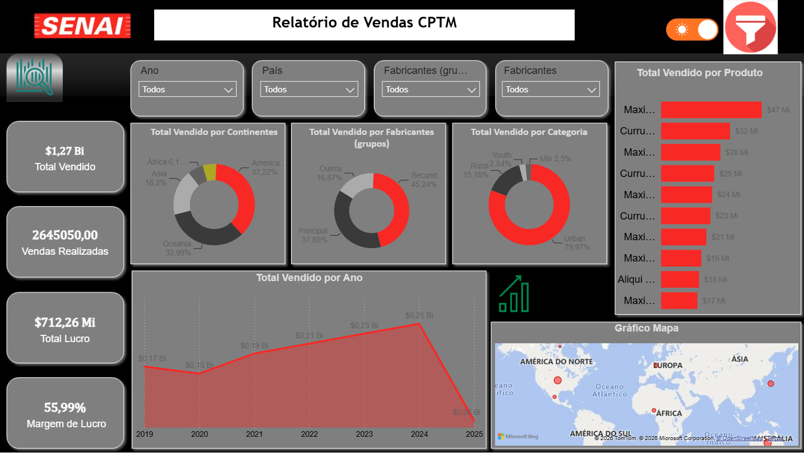
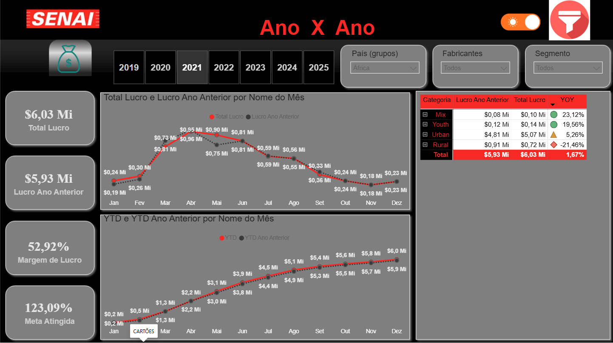

# 📊 Relatório de Vendas — Power BI

Projeto de análise e visualização de dados desenvolvido no **Microsoft Power BI**, durante as atividades do curso Técnico em Desenvolvimento de Sistemas do **SENAI**, com foco em Business Intelligence (BI), tratamento de dados e construção de dashboards interativos.

O projeto apresenta indicadores de vendas, lucro, margem de lucro, metas e comparações anuais, permitindo analisar o desempenho comercial por diferentes dimensões.

## 🛠️ Tecnologias utilizadas

- Microsoft Power BI Desktop
- Power Query — Extração e transformação de dados
- DAX — Medidas e indicadores
- Git e GitHub — Versionamento do projeto

## 📥 Como baixar e executar o projeto

### 1. Acessar o repositório

Acesse:

https://github.com/marianebatista966-hub/powerbi

### 2. Baixar o arquivo ZIP

1. Clique no botão verde **Code**.
2. Selecione **Download ZIP**.
3. Aguarde a conclusão do download.
4. Localize o arquivo ZIP no computador.

### 3. Extrair o arquivo ZIP

1. Clique com o botão direito sobre o arquivo baixado.
2. Selecione **Extrair Tudo**.
3. Escolha uma pasta de destino.
4. Abra a pasta extraída.

### 4. Abrir o projeto no Power BI

1. Instale o Microsoft Power BI Desktop, caso ainda não tenha.
2. Abra a pasta extraída.
3. Localize o arquivo `Aula8.pbip`.
4. Abra o arquivo utilizando o Power BI Desktop.
5. Aguarde o carregamento do relatório.

**Importante:** mantenha as pastas `Aula8.Report` e `Aula8.SemanticModel` junto ao arquivo `Aula8.pbip`, pois fazem parte da estrutura do projeto.

### 5. Obter dados

Caso seja necessário configurar novamente as fontes de dados:

1. Na guia **Página Inicial**, clique em **Obter dados**.
2. Selecione o tipo de fonte correspondente ao arquivo utilizado.
3. Localize a base de dados no computador.
4. Selecione os dados desejados.
5. Clique em **Transformar Dados** para acessar o Power Query ou em **Carregar** para importar diretamente.

### 6. Transformar dados

No Power Query, é possível preparar as informações antes da análise.

Entre as principais operações estão:

- Verificar e corrigir tipos de dados.
- Remover registros duplicados, quando necessário.
- Tratar valores nulos e inconsistentes.
- Renomear colunas.
- Filtrar registros.
- Organizar tabelas para análise.

Após realizar as transformações necessárias, clique em **Fechar e Aplicar**.

### 7. Atualizar os dados

Com o relatório aberto:

1. Acesse **Página Inicial**.
2. Clique em **Atualizar**.
3. Aguarde a atualização das consultas.
4. Verifique se os gráficos e indicadores foram carregados corretamente.

Caso apareça algum erro de caminho, verifique as configurações das fontes de dados e informe a localização correta dos arquivos no computador.

---

## 📈 Dashboard 1 — Visão Geral



### Objetivo

O dashboard **Relatório de Vendas CPTM** apresenta uma visão consolidada do desempenho comercial, reunindo indicadores financeiros, distribuição das vendas e evolução temporal.

Sua finalidade é facilitar a interpretação dos dados e identificar padrões de desempenho.

### Indicadores principais

| Indicador | Valor apresentado | Descrição |
|---|---|---|
| Total Vendido | $1,27 Bi | Valor total das vendas |
| Vendas Realizadas | 2.645.050 | Quantidade de vendas registradas |
| Total Lucro | $712,26 Mi | Lucro total apresentado |
| Margem de Lucro | 55,99% | Percentual de lucro em relação às vendas |

### Visualizações

**1. Total Vendido por Continentes**

Gráfico de rosca que apresenta a participação de cada continente nas vendas totais.

Permite identificar as regiões com maior representatividade comercial.

**2. Total Vendido por Fabricantes (grupos)**

Gráfico de rosca que compara a distribuição das vendas entre os grupos de fabricantes.

Facilita a análise da participação de cada grupo no resultado geral.

**3. Total Vendido por Categoria**

Apresenta a distribuição das vendas entre as categorias de produtos.

No relatório apresentado, a categoria Urban possui a maior participação percentual.

**4. Total Vendido por Produto**

Gráfico de barras horizontais que compara o valor vendido por produto.

Permite identificar os produtos com maior contribuição para o faturamento.

**5. Total Vendido por Ano**

Gráfico de área que demonstra a evolução anual das vendas entre 2019 e 2025.

Possibilita analisar oscilações, crescimento e redução dos valores ao longo do período.

**6. Gráfico Mapa**

Representação geográfica dos dados de vendas.

Permite visualizar a distribuição espacial dos registros e identificar localidades presentes na base.

### Filtros interativos

O dashboard possui segmentações para:

- Ano
- País
- Fabricantes (grupos)
- Fabricantes

Esses filtros permitem personalizar a análise e comparar diferentes subconjuntos de dados.

---

## 📉 Dashboard 2 — Ano X Ano



### Objetivo

O dashboard **Ano X Ano** foi desenvolvido para comparar o desempenho financeiro entre períodos, analisando o lucro atual em relação ao ano anterior.

A visualização também apresenta indicadores acumulados, margem de lucro, metas e variação percentual.

### Indicadores principais

| Indicador | Valor apresentado | Descrição |
|---|---|---|
| Total Lucro | $6,03 Mi | Lucro no período selecionado |
| Lucro Ano Anterior | $5,93 Mi | Lucro do período equivalente no ano anterior |
| Margem de Lucro | 52,92% | Margem percentual apresentada |
| Meta Atingida | 123,09% | Percentual de cumprimento da meta |

### Visualizações

**1. Total Lucro e Lucro Ano Anterior por Nome do Mês**

Gráfico de linhas que compara os valores mensais de lucro entre o período selecionado e o ano anterior.

Permite identificar:

- Meses de crescimento ou redução do lucro.
- Diferenças entre períodos equivalentes.
- Oscilações de desempenho financeiro.
- Possíveis tendências sazonais.

**2. YTD e YTD Ano Anterior por Nome do Mês**

Gráfico de linhas que compara os resultados acumulados desde o início do ano.

O indicador YTD (*Year to Date*) representa o valor acumulado até determinado momento do ano.

Essa visualização permite acompanhar a evolução acumulada do lucro e compará-la ao mesmo período do ano anterior.

**3. Matriz de Categorias — YOY**

Tabela que apresenta a comparação entre os resultados financeiros por categoria.

As colunas incluem:

- Categoria
- Lucro Ano Anterior
- Total Lucro
- YOY

O indicador YOY (*Year over Year*) representa a variação percentual entre o período atual e o período correspondente do ano anterior.

A matriz utiliza símbolos visuais para facilitar a identificação de variações positivas e negativas.

No relatório apresentado, a categoria Rural registra variação negativa, enquanto Mix, Youth e Urban apresentam variações positivas.

### Filtros interativos

O dashboard permite selecionar:

- Ano, de 2019 a 2025
- País (grupos)
- Fabricantes
- Segmento

Esses recursos permitem comparar os indicadores financeiros conforme os filtros selecionados.

---

## 🗂️ Estrutura do repositório

```text
powerbi/
│
├── Aula8.pbip
├── Aula8.Report/
├── Aula8.SemanticModel/
├── AtualizaçãoBase/
├── VendasInternacionais/
├── VendasMatriz/
│
├── img/
│   ├── geral.png
│   └── anoxano.png
│
├── .gitignore
└── README.md
```

A pasta `img/` deverá conter as capturas de tela utilizadas na documentação.

## 💻 Utilizando Git

Além do download pelo navegador, o projeto pode ser obtido utilizando Git.

### Clonar o repositório

```bash
git clone https://github.com/marianebatista966-hub/powerbi.git
```

### Acessar a pasta

```bash
cd powerbi
```

### Verificar alterações

```bash
git status
```

### Adicionar arquivos modificados

```bash
git add .
```

### Criar um commit

```bash
git commit -m "Atualiza documentacao do projeto Power BI"
```

### Enviar alterações ao GitHub

```bash
git push origin main
```

O envio de alterações exige permissão de escrita no repositório.

### Atualizar o repositório local

```bash
git pull origin main
```

---

## 🎯 Objetivos de aprendizagem

O desenvolvimento deste projeto permite aplicar conhecimentos relacionados a:

- Business Intelligence.
- Análise exploratória de dados.
- Construção de dashboards interativos.
- Tratamento e transformação de dados.
- Comparação de indicadores financeiros.
- Análise temporal e geográfica.
- Utilização de medidas DAX.
- Versionamento de projetos com Git e GitHub.

## 📌 Considerações finais

O projeto demonstra a aplicação do Power BI na organização, transformação e visualização de dados comerciais.

Os dashboards permitem acompanhar resultados, comparar períodos, analisar categorias e explorar informações por meio de filtros interativos.

Dessa forma, o relatório contribui para o desenvolvimento de habilidades em análise de dados e na comunicação visual de indicadores.

---

**Projeto acadêmico — SENAI | Técnico em Desenvolvimento de Sistemas**
